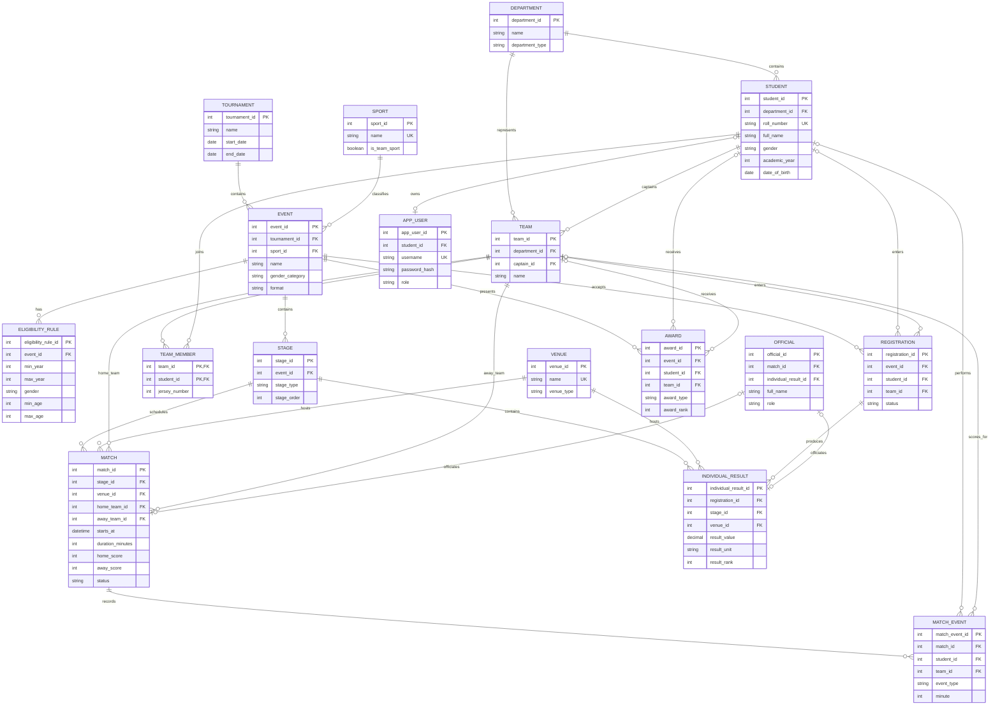

# ER Design

## Notation and design decisions

The diagram uses Mermaid ER notation with crow's-foot cardinalities. A circle means optional participation, a bar means exactly one, and a crow's foot means many. Associative entities resolve many-to-many relationships.

`registration` has nullable `student_id` and `team_id`, with exactly one required by a future `CHECK`. A single foreign key cannot legally point to both `student` and `team`, so two ordinary foreign keys are safer than a polymorphic ID. `official` uses the same pattern for assignment to either a match or an athletics result/heat.

## Mermaid ER diagram

## Relationship and participation table

| Relationship | Cardinality | Participation | Resolution or rule |
|---|---|---|---|
| Department–Student | 1:N | Student total; department optional | `student.department_id` |
| Department–Team | 1:N | Team total; department optional | `team.department_id` |
| Student–Team as captain | 1:N | Team total; student optional | `team.captain_id` |
| Tournament–Event | 1:N | Event total | `event.tournament_id` |
| Sport–Event | 1:N | Event total | `event.sport_id` |
| Event–EligibilityRule | 1:N | Rule belongs to event | `eligibility_rule.event_id` |
| Event–Registration | 1:N | Registration total | `registration.event_id` |
| Student/Team–Registration | 1:N per target | Registration total to exactly one target | two nullable FKs plus `CHECK` |
| Team–Student as members | M:N | Membership is optional on both sides | resolved by `team_member` |
| Event–Stage | 1:N | Stage total | `stage.event_id` |
| Stage–Match | 1:N | Match total | `match.stage_id` |
| Venue–Match | 1:N | Match total | `match.venue_id`; overlap trigger |
| Team–Match as home/away | each role 1:N | Match requires two distinct teams | two role-specific FKs and check |
| Match–MatchEvent | 1:N | Event total | `match_event.match_id` |
| MatchEvent–Student/Team | optional references | Event may identify performer and team | consistency checks |
| Official–Match/Result | 1:0..1 per assignment | Assignment targets exactly one type | two nullable FKs plus `CHECK` |
| Registration–IndividualResult | 1:N | Result belongs to registration | `individual_result.registration_id` |
| Stage/Venue–IndividualResult | 1:N each | Result requires both | two FKs |
| Event–Award | 1:N | Award belongs to event | `award.event_id` |
| Student/Team–Award | optional references | Award targets exactly one recipient | two nullable FKs plus `CHECK` |
| Student–AppUser | 0..1:0..1 | User may be linked to one student | nullable unique FK |

## Weak and associative entities

- `team_member` is an associative entity with a composite identity (`team_id`, `student_id`) and cannot exist without both owners.
- `match_event` is existence-dependent on `match`; its details have no meaning outside that match.
- `individual_result` is existence-dependent on a registration and a stage.
- `registration` and `award` use ordinary foreign keys with an exclusive-target check rather than an unsafe polymorphic foreign key.
